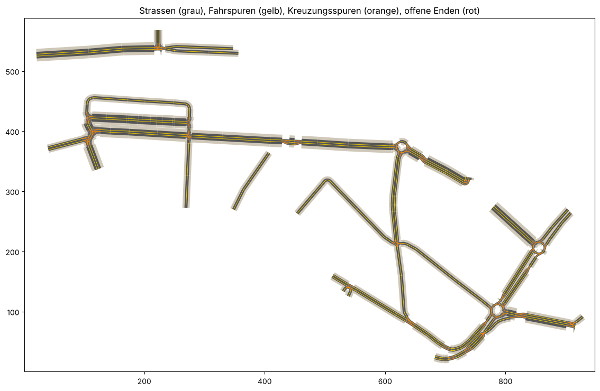

# OMSIgen – Editor und Generator für OMSI-2-Karten

OMSIgen ist der Karteneditor (Rust, `editor/`) mit allen seinen Funktionen und der Generator `omsigen` (Python)
dahinter. Die Karte, die damit entsteht, ist Aschaffenburg; Pilotstrecke ist die Buslinie 16
(Hauptbahnhof – Klinikum – Haibach „Am Wingert“).

**Test und Prod:** Entwickelt und ausprobiert wird in TEST (Zweig `main`, dieser Ordner, Fenstertitel „OMSIgen TEST“).
Getestete Stände werden mit `python tools/release.py X.Y.Z "Beschreibung"` zu einem Release: Zweig `prod`, Tag `vX.Y.Z`,
eigener Ordner `..\OMSIgen-Prod` mit eigenem Build (Fenstertitel „OMSIgen“). Beide bearbeiten dieselben Karten;
getrennt sind Code, Build und Protokolle. Versionen: [CHANGELOG.md](CHANGELOG.md).

**Kartendaten** (Fassaden, Messungen, Korrekturen, Projekte, Sonderbau Ring) liegen nicht im Code, sondern in
`Documents\Aschaffenburg` (`OMSIGEN_KARTENDATEN`), gemeinsam für TEST und PROD.



## Generator

`omsigen` baut aus offenen Daten eine befahrbare OMSI-2-Karte. Man gibt Start, Ziel und Zwischenziele vor; das Tool
sucht die Strecke über das echte Straßennetz und erzeugt alles in einem Korridor darum:

| Ebene | Was entsteht | Quelle |
|---|---|---|
| Netz | Straßen mit echten Querschnitten (Breite, Spuren, Gehweg, Rad, Parken, Abbiegestreifen), Kreuzungsobjekte mit exakt verbundenen Spuren, Vorfahrt, Ampeln, Kreisverkehre, Querschnittsübergänge, Brücken und Tunnel | OSM, LoD2-Gebäudeflucht |
| Höhen | Straßen auf dem Gelände, Kreuzungsplatten am Gefälle geneigt, stetige Steigung (`[spline_h]`), Böschungen statt Stufen | DGM1 Bayern |
| Boden | Malmasken je Kachel: Gras, Erde, Schotter, Pflaster, Asphalt, Wasser | Luftbild DOP20, OSM-Flächen |
| Gebäude | LoD2-Gebäude mit Fassadenfotos, auf dem Kartengelände gegründet, nach Hauptachse gedreht | LoD2 Bayern, Fassaden aus `earth-reverse-engineering` |
| Ausstattung | Laternen, Verkehrszeichen passend zur Vorfahrt, Poller, Bänke, Mülleimer, Zäune; Haltestellen mit Mast, Namensschild, Wartehalle, Hochbord | OSM, Regeln je Straßenklasse |

Dazu je Karte: Geobezug im UTM-Gitter (`omsi-editor-geo.cfg`), Schichten je Kachel (einzeln neu baubar,
`schichten.json`), das Netz als `netz.json`, eine Belegungskarte (Fahrbahn/Gehweg/Gebäude …) und ein Prüfbericht.

### Schnellstart (Windows)

```powershell
pip install -r requirements.txt
py -3.12 -m omsigen --omsi "C:\Program Files (x86)\Steam\steamapps\common\OMSI 2" `
    --von 49.98015,9.14104 --nach 49.97585,9.16269 --ueber 49.97672,9.14859 `
    --name Aschaffenburg_Test_v1 --titel "Aschaffenburg Test" --gebaeude 100
py -3.12 -m omsigen.pruefbericht Aschaffenburg_Test_v1 --bilder --luftbild --max 6
```

Den vollständigen Befehl für die Pilotkarte Linie 16 enthält [docs/qualitaet-anforderungen.md](docs/qualitaet-anforderungen.md)
(„Pilotkarte Linie 16 erzeugen“). Vorhandene Karten werden nie überschrieben – jede Version bekommt einen neuen Namen
(`_v2`, `_v3` …). Der Generator endet mit Rückgabe ≠ 0, solange offene Spurenden gefunden werden; den Prüfbericht dann
getrennt starten.

| Option | Bedeutung |
|---|---|
| `--von`, `--nach` | Ortsname (mit `--stadt`) oder Koordinaten `"49.9805,9.1402"` |
| `--ueber` | Zwischenziel, mehrfach möglich – damit lässt sich eine Buslinie nachfahren |
| `--breite` | Korridor links/rechts der Strecke in Metern (Standard 150) |
| `--gebaeude [BREITE]` | LoD2-Gebäude im Korridor (mit Fassaden, sofern vorhanden) |
| `--querschnitte osm\|standard` | echte Querschnitte (Standard) oder die feste Marcel-Liste |
| `--omsi` | OMSI-Ordner: Karte, Splines und Objekte werden direkt installiert |
| `--osm-datei` | Daten aus Datei statt Download, z. B. `samples/aschaffenburg_hbf_citygalerie.json` |
| `--korrekturen` | eigene Korrekturen (Vorfahrt, Ampel), JSON |

Ohne Internet/OMSI ausprobieren:

```bash
py -3.12 -m omsigen --von "49.98053,9.14023" --nach "49.97790,9.14998" --name Test \
    --osm-datei samples/aschaffenburg_hbf_citygalerie.json --vorschau vorschau.png
py -3.12 -m pytest
```

`python` ist auf diesem Rechner ein leeres Python 3.15 – Generator und Tests laufen mit `py -3.12`.

## Karteneditor (Rust)

Bauen, Starten und alle Werkzeuge: [editor/README.md](editor/README.md). Kurz:

```powershell
cd editor
cargo build --release
target\release\omsi-editor.exe                 # Startbildschirm mit Kartenauswahl
```

Die Darstellung kommt aus [openOMSI](https://github.com/openOMSI-Project/openOMSI) (Zweig `editor-api`, Patch in
`editor/patches/`). Neben der exe müssen `dxcompiler.dll` und `dxil.dll` aus einem openOMSI-Release liegen, sonst
bricht das Rendern ohne Fenster mit einem Stapelüberlauf ab. Der Editor ist das Hauptprodukt: jede Funktion des
Generators soll dort bedienbar sein (Schichten neu bauen, Belegung und Prüfbericht ansehen, Querschnitt-Baukasten,
Vermessen, Sonderbau, Gelände formen).

## Prüfen und vergleichen

```powershell
py -3.12 -m omsigen.pruefbericht <Karte> --bilder --luftbild     # Funde je Kachel, Budgets, Spiel- und Luftbilder
py -3.12 -m omsigen.vorbildstudie "Ahlheim 5" "Städtedreieck_V3" <Karte>   # Straßen/Kreuzungen gegen die Vorbilder
py -3.12 -m omsigen.ansicht <Karte> --png build/ansicht.png --html build/ansicht.html   # Spuren, Beinahe-Anschlüsse
py -3.12 -m omsigen.openomsi <Karte> --png build/spiel.png --cam 390,320,60,0,-40       # Spielbild aus openOMSI
py -3.12 -m omsigen.luftbildvergleich --karte <Karte> --bereich x0 z0 x1 z1   # Boden, Markierungen, Borde gegen DOP
```

Maßstab für die Qualität sind **Ahlheim 5** und **Städtedreieck V3**: [docs/musterbuch.md](docs/musterbuch.md) hält
fest, wie sie Straßen und Kreuzungen bauen (gemessen), und welche Regeln daraus für OMSIgen gelten.

## Qualitätsplan und Stand

[docs/qualitaet-anforderungen.md](docs/qualitaet-anforderungen.md) beschreibt Anforderungen und Ablauf:

| Phase | Inhalt | Stand |
|---|---|---|
| 0 | Fundament: Geobezug, Schichten, Netz-Datei, Belegungskarte, Prüfbericht | erledigt |
| 1 | S1 Querschnitte, S4 Boden | erledigt (Breiten an 2 von 20 Prüfstellen < 0,5 m – offen) |
| 2 | G1 Gebäude-Platzierung, G3 Straßenobjekte, G4 Haltestellen | erledigt |
| – | Straßenlogik nach Vorbild (Musterbuch): Kreuzungen am Gefälle | erledigt; Linienführung, Kreuzungsgröße und Straßenraummodell als Vorstufe folgen |
| 3 | Bäume, Parks | offen |
| 4 | Markierungen, Fußgängerampeln, Fassaden, Backdrops, Texturwerkstatt | offen |
| 5 | LOD/Budgets, Fahrpläne | offen |

## Projektaufbau

```
editor/              Karteneditor (Rust, auf openOMSI); README mit allen Werkzeugen
omsigen/
  cli.py, pipeline.py      Kommandozeile; Import (OSM -> Projekt) und Erzeugen (Projekt -> Karte)
  osm.py, route.py         OSM laden, Routing, Korridor, Projektion (UTM)
  network.py               Kanten, Knoten, Kreisverkehre, Ketten, Kreuzungsspuren
  querschnitte.py          echte Querschnitte (S1); querschnitt_messung.py, querschnitt_pruefung.py
  kreuzung.py              Kreuzungsobjekte (.sco + .x), geneigte Platten
  vorfahrt.py, ampel.py    Vorfahrt je Kreuzung, Ampelprogramme
  gelaende.py, hoehen.py   DGM1 Bayern; Straßenhöhen, Kreuzungsebenen, Ausrundung, Geländeraster
  bauwerke.py              Brückenkörper, Tunnelröhren, Pfeiler, Portale
  boden.py                 Malmasken je Kachel (S4)
  lod2.py, platzierung.py  LoD2-Gebäude, Gründung, Drehung, Konflikte (G1)
  ausstattung*.py          Straßenausstattung (G3); haltestellen.py (G4)
  schichten.py             Schichten je Kachel (Pakete, Manifest, veraltet?)
  netz_datei.py            netz.json aus der Karte ableiten
  belegung.py              Belegungskarte je Kachel
  pruefbericht.py          Prüfbericht je Kachel
  vorbildstudie.py         Karten vermessen und mit den Vorbildern vergleichen
  writer.py                Kartenordner schreiben (UTF-16, [spline_h])
  ansicht.py, openomsi.py  Karten ansehen, Spielbilder rendern
docs/                omsi-format.md (Dateiformat), musterbuch.md, qualitaet-anforderungen.md, kartenstudie.md
tools/release.py     Release TEST -> PROD
samples/             Testdaten (OSM-Auszug Aschaffenburg)
tests/               pytest
```

Benötigt die Standardinhalte von OMSI 2 (Splines `Marcel`, `template/NewMap`) sowie die Add-ons **Rheinhausen** und
**PAD-Labs** (Bodentexturen, Ausstattung); erzeugte Karten nennen sie in ihrer Beschreibung.

## Daten und Lizenz

- Straßendaten © OpenStreetMap-Mitwirkende, [Open Database License](https://www.openstreetmap.org/copyright).
- Geländemodell DGM1, Luftbild DOP20/DOP40, LoD2-Gebäude, Laserdaten: Bayerische Vermessungsverwaltung, CC BY 4.0.

Erzeugte Karten enthalten die Quellenangaben; beim Weitergeben bitte beibehalten. Alle Karten sind privat.
